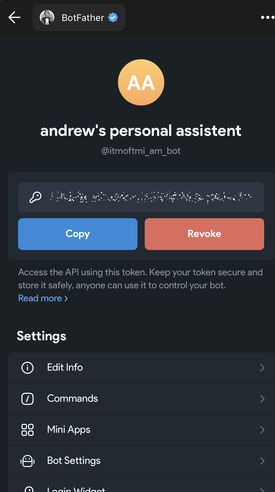
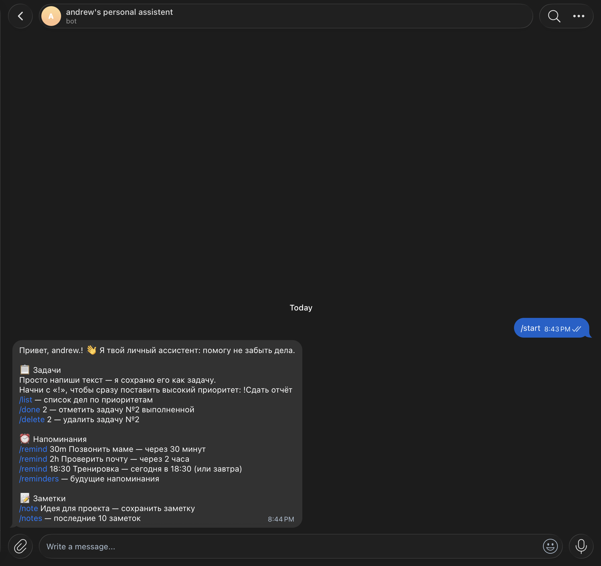
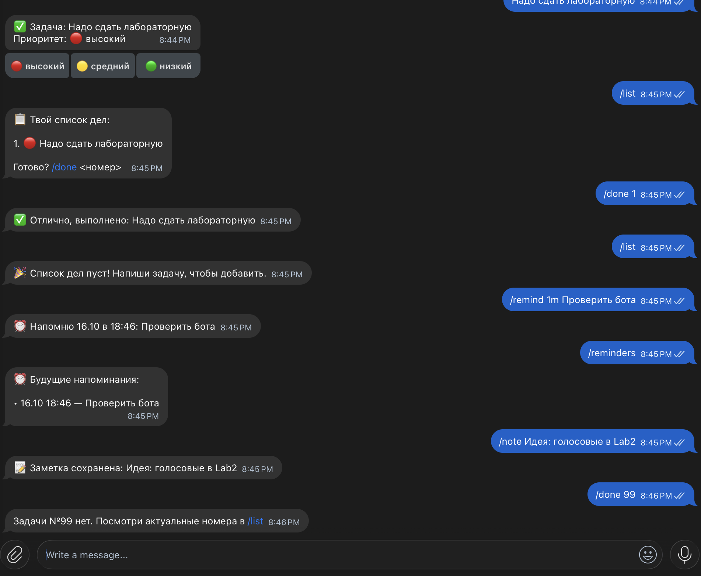
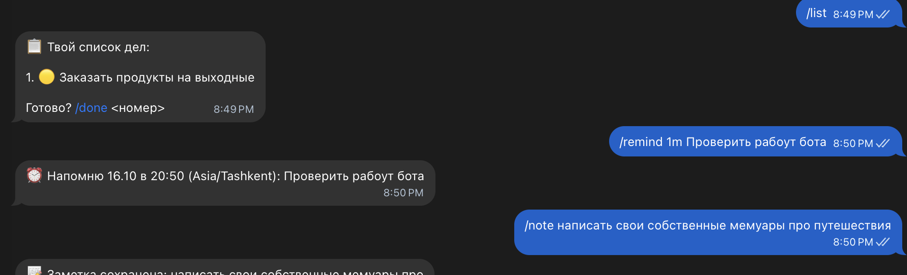

University: [ITMO University](https://itmo.ru/ru/)
Faculty: [FTMI](https://ftmi.itmo.ru/)
Course: [Vibe Coding for Business](https://ex-itmo-ict-faculty.github.io/vibe-coding-for-business/)
Year: 2026/2027
Group: U4225
Author: Михно Андрей Анатольевич
Lab: Lab1
Date of create: 10.10.2026
Date of finished: —

# Лабораторная работа 1: Создание первого Telegram-бота без программирования

## 1. Описание задачи

Выбран вариант 3 — **бот-ассистент для задач**.

**Проблема.** Мелкие дела, идеи и «не забыть бы» приходят в голову в течение дня и теряются:
записывать их в отдельное приложение неудобно, а Telegram всегда под рукой. Нужен личный
помощник прямо в мессенджере, которому можно быстро написать задачу и который сам напомнит
о важном.

**Почему эта задача.** Это основа моего персонального ассистента, который будет развиваться
в следующих лабораторных: в Lab2 он научится принимать голосовые сообщения и добавлять
события в Google Calendar, в Lab3 будет развёрнут на собственном сервере.

**Функционал Lab1:**
- любое текстовое сообщение сохраняется как задача;
- приоритеты 🔴 высокий / 🟡 средний / 🟢 низкий: `!` в начале — высокий, смена приоритета inline-кнопками;
- список дел `/list`, отсортированный по приоритету; `/done`, `/delete` по номеру;
- напоминания `/remind 30m | 2h | 18:30 <текст>`, переживающие перезапуск бота;
- заметки `/note`, `/notes`.

## 2. Создание бота в Telegram

Бот создан через @BotFather: **andrew's personal assistent**, username `@itmoftmi_am_bot`.



## 3. Промпт для LLM

Использовалась LLM **Claude** (Claude Code, модель Claude Opus 5.5).
Промпт составлен по шаблону из методички: функционал, команды, манера ответов, хранимые
данные, требования и список файлов. Полный текст и история итераций — в [prompt.md](prompt.md).

### Исходный промпт

См. [prompt.md → Версия 1](prompt.md#версия-1-исходный-промпт).

### Итерации

1. **Итерация 1 — первый запуск.** Код по исходному промпту сгенерирован с первого раза:
   бот запустился без ошибок, все команды работали.
2. **Итерация 2 — часовой пояс.** При тесте `/remind` бот показал время по Москве, а не по
   Ташкенту. LLM было отправлено уточнение (текст в [prompt.md](prompt.md#итерация-2--неверное-время-напоминаний)):
   показывать часовой пояс в ответе на `/remind` и подсказать в `.env.example`, что пояс нужно
   указать свой.

### Финальный промпт

Исходный промпт + уточнение про часовой пояс из итерации 2,
см. [prompt.md → Финальный промпт](prompt.md#финальный-промпт).

## 4. Стек технологий

| Технология | Зачем | Почему выбрана |
|---|---|---|
| Python 3 | язык бота | самый простой вариант для ботов, рекомендован в методичке |
| python-telegram-bot 22 | работа с Telegram Bot API | официально рекомендован, асинхронный, хорошая документация |
| JobQueue (APScheduler) | отложенная отправка напоминаний | встроен в python-telegram-bot, не нужен отдельный планировщик |
| SQLite (`sqlite3`) | хранение задач, напоминаний, заметок | встроен в Python, не требует сервера, один файл |
| python-dotenv | чтение токена из `.env` | токен не попадает в код и в Git |
| tzdata / zoneinfo | часовые пояса | корректное время напоминаний на любой ОС |

## 5. Генерация кода и запуск

Сгенерированные файлы:
- [bot.py](bot.py) — код бота;
- [requirements.txt](requirements.txt) — зависимости;
- [README.md](README.md) — инструкция по установке и запуску;
- [.env.example](.env.example) — пример конфигурации.

Запуск:

```bash
cd lab1
python3 -m venv .venv && source .venv/bin/activate
pip install -r requirements.txt
cp .env.example .env   # вписать BOT_TOKEN
python bot.py
```

## 6. Тестирование: скриншоты и видео

**Приветствие и справка (`/start`).** Бот здоровается по имени и показывает все команды
с примерами, сгруппированные по разделам: задачи, напоминания, заметки.



**Основной сценарий.** На одном скриншоте проверены все функции бота:

| Действие | Ожидаемый результат | Итог |
|---|---|---|
| `!Надо сдать лабораторную` | задача с высоким приоритетом 🔴 и кнопками смены приоритета | ✅ |
| `/list` | список дел, отсортированный по приоритету, с номерами | ✅ |
| `/done 1`, затем `/list` | задача отмечена выполненной, список пуст | ✅ |
| `/remind 1m Проверить бота` | подтверждение с временем срабатывания | ✅ |
| `/reminders` | напоминание есть в списке будущих | ✅ |
| _через минуту_ | приходит сообщение «⏰ Напоминание: Проверить бота» (в БД `is_sent = 1`) | ✅ |
| `/note Идея: голосовые в Lab2` | заметка сохранена | ✅ |
| `/done 99` | понятное сообщение об ошибке с подсказкой | ✅ |



На этом же скриншоте видна проблема с часовым поясом: в 20:45 бот пообещал напомнить «в 18:46»
(см. раздел 7).

**Напоминания после исправления часового пояса (итерация 2).** В 20:50 бот обещает напомнить
«в 20:50 (Asia/Tashkent)», то есть время совпадает с местным, и пояс указан явно:



Через минуту напоминание приходит:


Видео-демо (3 мин): [demo/demo.mp4](demo/demo.mp4) — задачи, приоритеты, список дел, напоминания, заметки, обработка ошибок.

## 7. Трудности и решения

| Трудность | Решение |
|---|---|
| Время напоминаний показывалось по Москве (18:46), хотя я в Ташкенте (20:45). Само напоминание пришло вовремя, потому что время хранится в UTC, но отображение путало. | В `.env` указан `TIMEZONE=Asia/Tashkent`. Итерацией промпта добавлен вывод часового пояса в ответе на `/remind` и подсказка в `.env.example`. |
| Повторный `cp .env.example .env` перезаписал файл с уже вписанным токеном. | Токен вписан заново. Вывод: `.env` создаётся один раз, дальше только редактируется. |
| Токен нельзя хранить в коде и Git. | Токен читается из `.env` через python-dotenv, `.env` добавлен в `.gitignore`, в репозитории только `.env.example`. |

## 8. Выводы

**Что получилось хорошо.** Работающий бот-ассистент получен по одному подробному промпту
практически с первого раза. Все заявленные функции работают: задачи с приоритетами,
список дел, напоминания, заметки. Данные хранятся в SQLite, а напоминания не теряются при
перезапуске бота.

**Что можно улучшить.**
- Добавить меню команд Telegram (кнопка «/» рядом с полем ввода) через `set_my_commands`.
- Понимать время в свободной форме («завтра в 10», «в пятницу»).
- Принимать голосовые сообщения и создавать события в Google Calendar. Это план на Lab2.
- Перенести бота на сервер, чтобы он работал круглосуточно. Это план на Lab3.

**Чему научился.** Структурированный промпт (функционал → команды → стиль → данные →
требования → файлы) даёт рабочий код с первой итерации. Чем точнее описаны форматы команд
и структура БД, тем меньше правок. Ошибки при тестировании удобно превращать в короткие
уточняющие промпты с конкретным примером: «ожидал X, получил Y».
