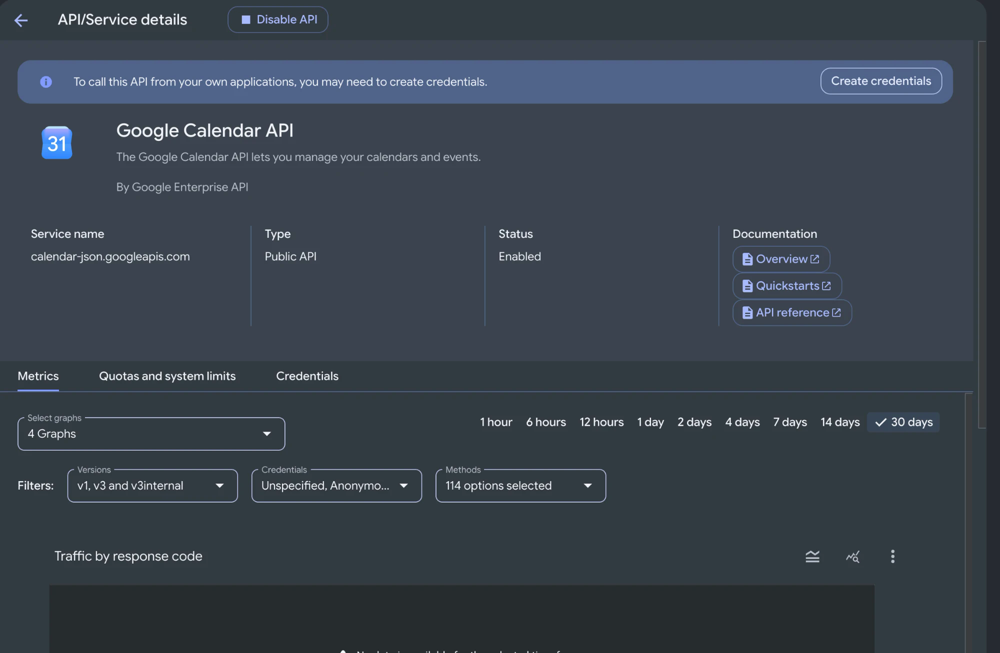
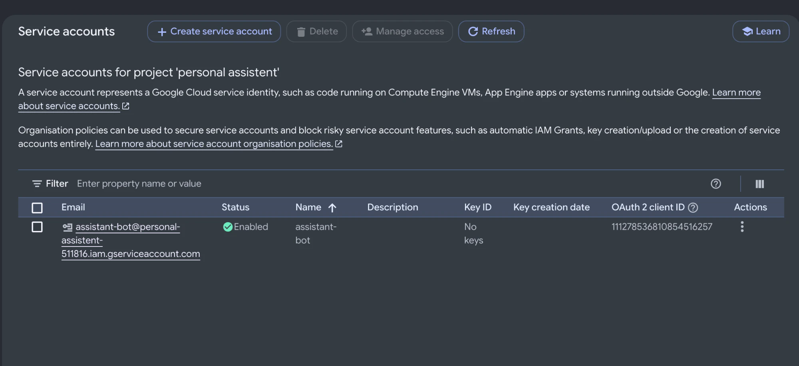
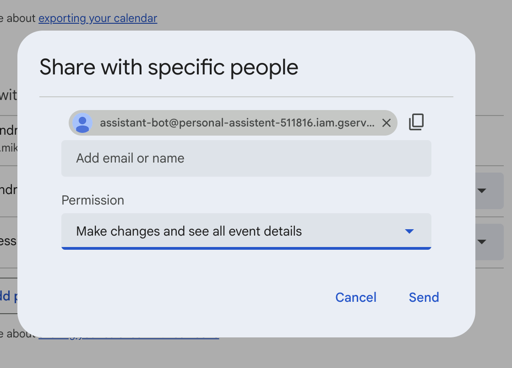
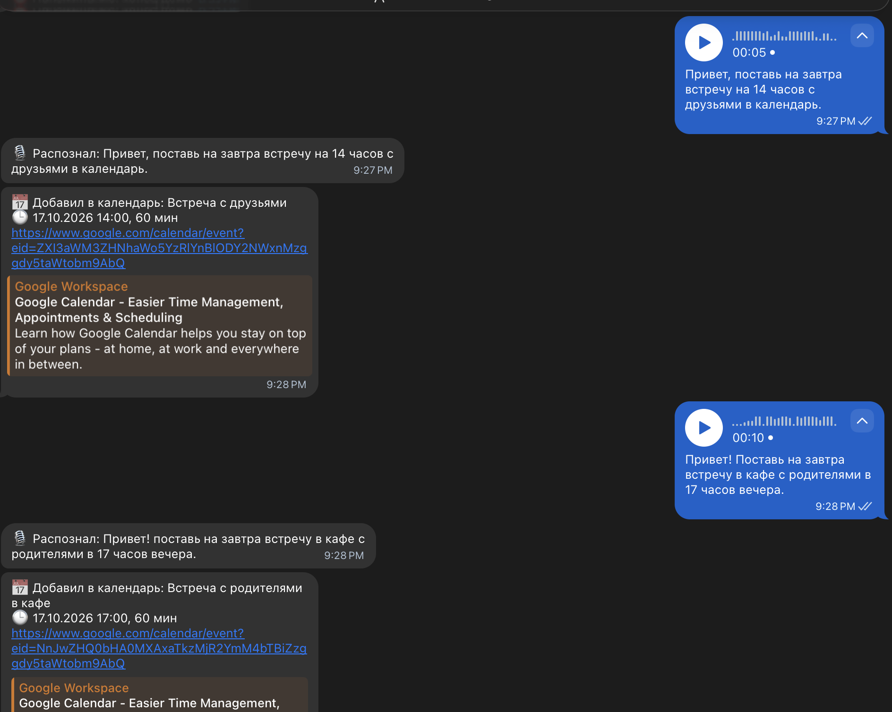
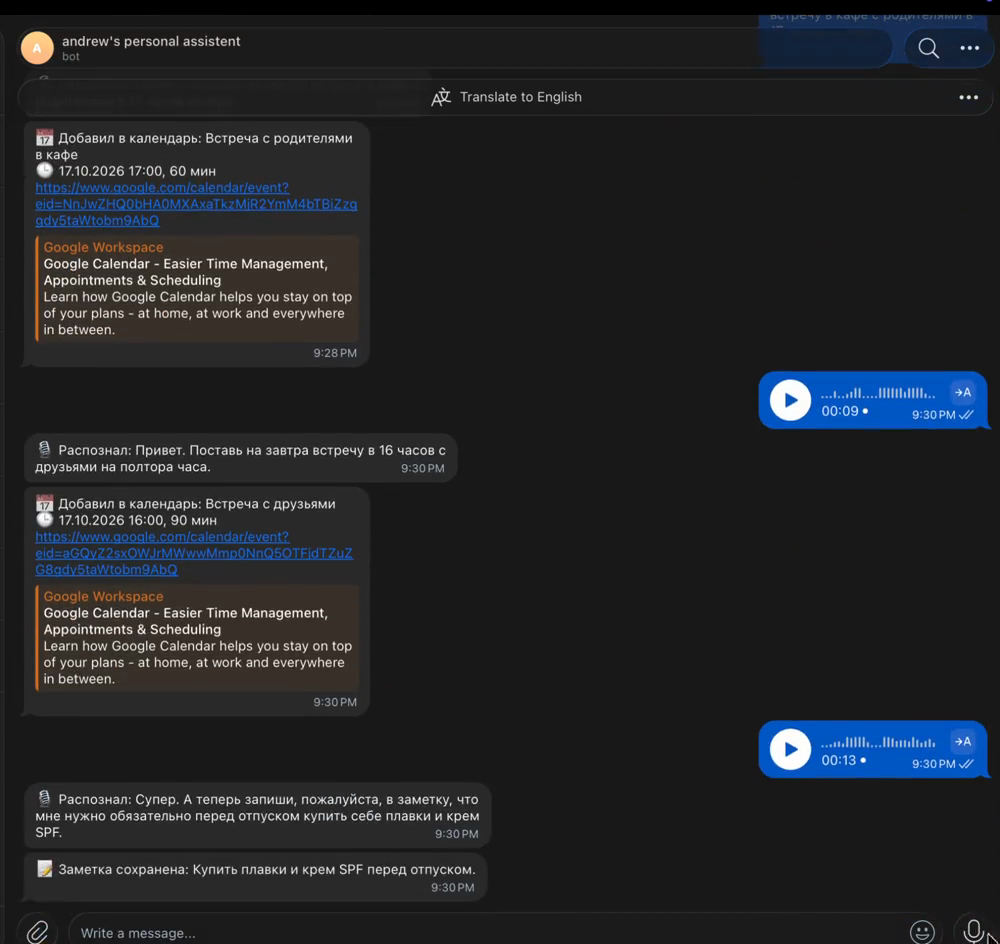
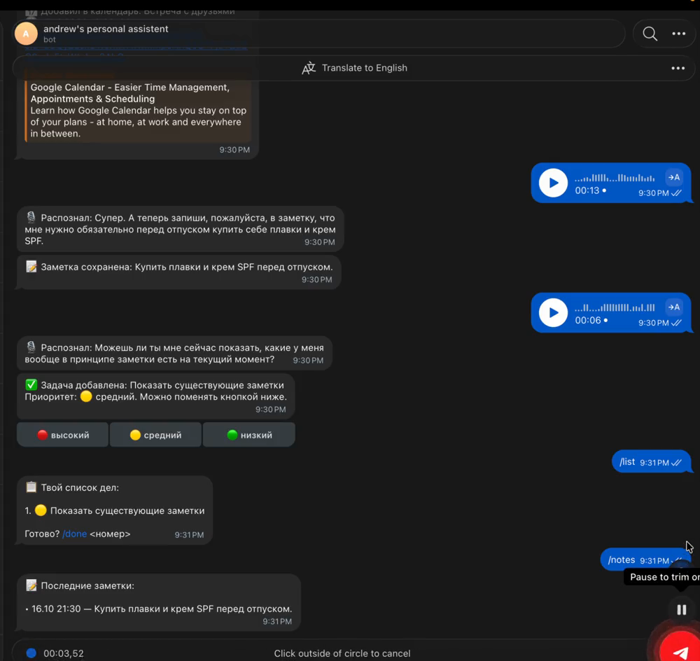

University: [ITMO University](https://itmo.ru/ru/)
Faculty: [FTMI](https://ftmi.itmo.ru/)
Course: [Vibe Coding for Business](https://ex-itmo-ict-faculty.github.io/vibe-coding-for-business/)
Year: 2026/2027
Group: U4225
Author: Михно Андрей Анатольевич
Lab: Lab2
Date of create: 10.10.2026
Date of finished: —

# Лабораторная работа 2: Подключение бота к данным

## 1. Описание интеграции

Бот из Lab1 (задачи, приоритеты, напоминания, заметки в SQLite) научился принимать
**голосовые сообщения** и работать с **Google Calendar**. Использованы три источника данных:

| Источник | Тип | Для чего |
|---|---|---|
| **OpenAI Audio API** (`gpt-4o-mini-transcribe`) | публичный API | распознавание речи из голосового |
| **OpenAI Chat Completions** (`gpt-4o-mini`) | публичный API | разбор фразы: что хочет пользователь + извлечение даты/времени |
| **Google Calendar API v3** | публичный API | создание событий (`events.insert`), чтение ближайших (`events.list`) |
| **SQLite** (из Lab1) | база данных | задачи и заметки |

**Почему так.** Цель проекта — личный ассистент, которому можно надиктовать дело на ходу.
Голос удобнее текста, а календарь — то место, где дела с конкретным временем и должны жить.
Распознать речь и понять фразу вроде «поставь на завтра встречу в 17 с родителями»
без LLM нельзя, поэтому OpenAI — естественный выбор. Заметки по-прежнему хранятся в SQLite:
у Google Keep и Apple Notes нет публичного API для личных аккаунтов.

**Как устроен поток данных:**

```
Голосовое (ogg) ──► OpenAI Audio API ──► текст
                                           │
                     текущие дата/время/часовой пояс
                                           ▼
                              OpenAI Chat Completions (JSON)
                                           │
        ┌──────────────┬───────────────────┼──────────────────┐
        ▼              ▼                   ▼                  ▼
     "event"        "note"              "task"             "show"
  Google Calendar   SQLite notes      SQLite tasks    /list, /notes, /events
```

**Структура ответа модели (JSON):**

```json
{"action": "event", "title": "Встреча с друзьями", "start": "2026-10-17T14:00:00+05:00", "duration_minutes": 60}
{"action": "note",  "text": "Купить плавки и крем SPF перед отпуском"}
{"action": "task",  "text": "Купить подарок маме", "priority": 1}
{"action": "show",  "what": "notes"}
```

**Авторизация Google — сервисный аккаунт.** Он работает по JSON-ключу без браузерного входа
и без истекающих токенов, поэтому его легко перенести на сервер в Lab3. Календарь
пользователя расшарен на email сервисного аккаунта с правом вносить изменения.

| Включённый Google Calendar API | Сервисный аккаунт |
|---|---|
|  |  |

Доступ сервисного аккаунта к календарю:



## 2. Промпт для LLM

LLM: **Claude** (Claude Code, модель Claude Opus 5.5). Промпт составлен по шаблону методички:
вводная фраза → «Текущий функционал» → «Новый функционал» → «Данные» → «Требования» → «Создай».
Полные тексты — в [prompt.md](prompt.md).

- **Исходный промпт** — [prompt.md → Версия 1](prompt.md#версия-1-исходный-промпт).
- **Итерация 1** — код заработал с первого раза, обе интеграции проверены тестовым скриптом.
- **Итерация 2** — исправлены три ошибки, найденные на демо: просьба «покажи заметки»
  сохранялась как задача, «на 2 часа» не распознавалось как длительность, под ссылкой
  на событие было громоздкое превью. Подробности и таблица «было/стало» —
  [prompt.md → Итерация 2](prompt.md#итерация-2--ошибки-найденные-на-демо).
- **Финальный промпт** — [prompt.md → Финальный промпт](prompt.md#финальный-промпт).

## 3. Реализация

### Библиотеки

| Библиотека | Зачем |
|---|---|
| `python-telegram-bot` 22 | Telegram Bot API, приём голосовых, JobQueue |
| `openai` 3.x (`AsyncOpenAI`) | распознавание речи и разбор намерения; асинхронный клиент не блокирует бота |
| `google-api-python-client`, `google-auth` | Google Calendar API и авторизация сервисным аккаунтом |
| `sqlite3`, `python-dotenv`, `tzdata` | хранение данных, конфигурация, часовые пояса (из Lab1) |

### Ключевые фрагменты кода ([bot.py](bot.py))

**Распознавание речи** — голосовое из Telegram отправляется в OpenAI как есть (ogg/opus):

```python
async def transcribe_voice(audio: bytes) -> str:
    result = await openai_client.audio.transcriptions.create(
        model=OPENAI_STT_MODEL,
        file=("voice.ogg", audio),
    )
    return result.text.strip()
```

**Разбор намерения** — в системный промпт подставляются текущие дата, день недели и часовой пояс,
поэтому модель превращает «завтра», «в пятницу» в точную дату. Ответ — строго JSON:

```python
response = await openai_client.chat.completions.create(
    model=OPENAI_MODEL,
    response_format={"type": "json_object"},
    messages=[
        {"role": "system", "content": system_prompt},
        {"role": "user", "content": text},
    ],
)
intent = json.loads(response.choices[0].message.content)
if intent.get("action") not in ("event", "note", "task", "show"):
    raise ValueError(f"Неизвестное действие: {intent!r}")
```

**Создание события** — Google API синхронный, поэтому вызывается в отдельном потоке
через `asyncio.to_thread`, чтобы бот не «замирал»:

```python
def insert_event(title: str, start: datetime, duration_minutes: int) -> dict:
    end = start + timedelta(minutes=duration_minutes)
    body = {
        "summary": title,
        "start": {"dateTime": start.isoformat(), "timeZone": TIMEZONE.key},
        "end": {"dateTime": end.isoformat(), "timeZone": TIMEZONE.key},
    }
    return get_calendar_service().events().insert(calendarId=GOOGLE_CALENDAR_ID, body=body).execute()

event = await asyncio.to_thread(insert_event, title, start, duration)
```

### Обработка ошибок

Главный принцип — **фраза пользователя не теряется**: если что-то пошло не так, бот сообщает
об этом и сохраняет фразу как задачу.

| Ситуация | Поведение бота |
|---|---|
| нет `OPENAI_API_KEY` | бот запускается, на голосовое отвечает «Голосовые пока не настроены» |
| нет `credentials.json` / `GOOGLE_CALENDAR_ID` | `/events` — «Google Calendar не настроен»; событие сохраняется как задача |
| пустое распознавание | «Не расслышал, попробуй ещё раз» |
| ошибка OpenAI (`APIError`, сеть) | сообщение об ошибке; при разборе намерения — фраза сохраняется как задача |
| модель вернула не JSON / неизвестное действие | «Не понял, что сделать. Сохраню как задачу» |
| некорректная дата/длительность в ответе модели | «Не понял дату и время события. Сохраню как задачу» |
| ошибка Google Calendar (`HttpError`) | «Google Calendar вернул ошибку… Сохраню как задачу» |
| любая другая ошибка | глобальный `error_handler` из Lab1: лог + «Что-то пошло не так» |

## 4. Тестирование

### Проверка интеграций до запуска бота

Перед запуском бота интеграции проверены отдельным скриптом:

```
calendar configured: True | openai: True | models: gpt-4o-mini gpt-4o-mini-transcribe
Calendar OK, событий получено: 0
OpenAI OK: {'action': 'event', 'title': 'Созвон с командой', 'start': '2026-10-17T15:00:00+05:00', 'duration_minutes': 60}
```

### Работа в Telegram

**Голосовые → события в Google Calendar.** Бот показывает распознанный текст, создаёт
событие с правильной датой (17.10 — «завтра») и временем и присылает ссылку на него:



**Длительность и заметка.** «В 16 часов… на полтора часа» → событие на 90 минут;
«запиши в заметку…» → заметка в SQLite:



**Найденная ошибка (до итерации 2).** Просьба показать заметки сохранилась как задача:



### Примеры запросов и ответов

| Голосовое | Действие модели | Результат |
|---|---|---|
| «Поставь на завтра встречу на 14 часов с друзьями в календарь» | `event` 17.10 14:00, 60 мин | 📅 событие в Google Calendar |
| «Поставь на завтра встречу в кафе с родителями в 17 часов вечера» | `event` 17.10 17:00, 60 мин | 📅 событие в Google Calendar |
| «…в 16 часов с друзьями на полтора часа» | `event` 17.10 16:00, 90 мин | 📅 событие в Google Calendar |
| «Запиши в заметку… купить плавки и крем SPF» | `note` | 📝 заметка в SQLite, видна в `/notes` |
| «Можешь показать, какие у меня заметки?» | до итерации 2: `task` ❌ → после: `show notes` ✅ | список заметок |
| «…на завтра на 2 часа… время для фокуса» | до итерации 2: 60 мин ❌ → после: 120 мин ✅ | 📅 событие |

Видео-демо (2 мин): [demo/demo.mp4](demo/demo.mp4). На видео — поведение **до итерации 2**,
включая найденные ошибки.

## 5. Трудности и решения

| Трудность | Решение |
|---|---|
| В Google Cloud Console кнопка «Create credentials» дважды приводила в мастер **OAuth Client ID** (выбор типа приложения, scopes), который для бота не нужен. | Сервисный аккаунт создан напрямую на странице *IAM & Admin → Service accounts*, мастер OAuth не используется. |
| Сервисный аккаунт по умолчанию не видит личный календарь. | Календарь расшарен на email сервисного аккаунта с правом «Make changes and see all event details». |
| Два процесса бота (Lab1 и Lab2) не могут одновременно получать обновления одного Telegram-бота. | Перед запуском Lab2 бот Lab1 остановлен. |
| Новая версия `openai` 3.x пишет каждый HTTP-запрос в лог через логгер `httpx2`. | Уровень логгера `httpx2` поднят до WARNING, как для `httpx`. |
| Модель не всегда правильно понимает намерение: просьба «покажи заметки» стала задачей, «на 2 часа» не стало длительностью. | Итерация 2: новое действие `show`, уточнённые правила про длительность в системном промпте, проверка на 7 фразах. |
| Ключи (OpenAI, Google) нельзя хранить в Git. | Ключ OpenAI — в `.env`, ключ Google — в `credentials.json`; оба файла в `.gitignore`. |

## 6. Выводы

**Что получилось хорошо.** Бот понимает свободную речь: «поставь на завтра встречу в 17 с
родителями» превращается в событие Google Calendar с правильной датой и временем за пару
секунд. Три источника данных (OpenAI, Google Calendar, SQLite) работают вместе, весь
функционал Lab1 сохранён. Ошибки обработаны так, что надиктованное не теряется.

**Что можно улучшить (план на Lab3).**
- Подтверждение перед созданием события и кнопка «Отменить» — сейчас событие создаётся сразу.
- Удаление и перенос событий голосом.
- Напоминания голосом («напомни через час…») — сейчас только командой `/remind`.
- Двусмысленные фразы вроде «на 2 часа» (время начала или длительность?) — уточнять у пользователя.
- Развернуть бота на сервере, чтобы он работал круглосуточно, и собрать обратную связь.

**Чему научился.** Подключение внешнего API через LLM-сгенерированный код занимает минуты,
а основное время уходит на настройку доступа (Google Cloud) и на проверку того, как модель
понимает реальные фразы. Системный промпт для разбора намерений нужно тестировать на живых
формулировках: по ним видно, каких правил не хватает. Строгий JSON-ответ
(`response_format=json_object`) и валидация полей делают работу с LLM предсказуемой.
