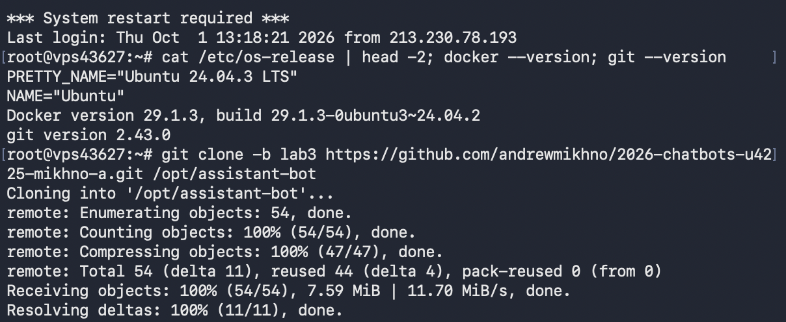
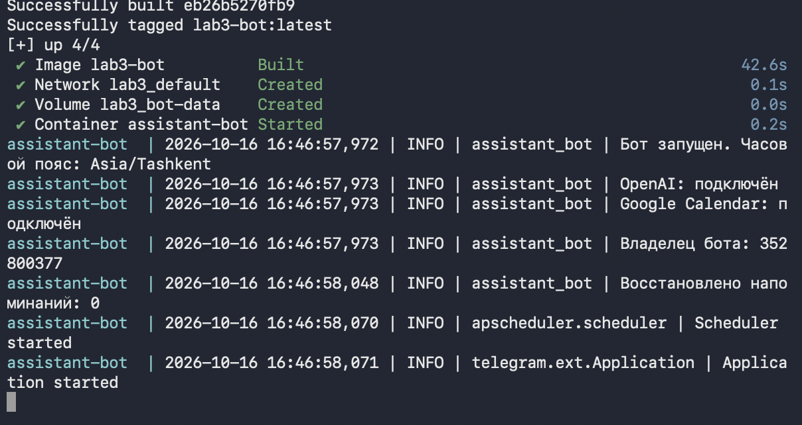
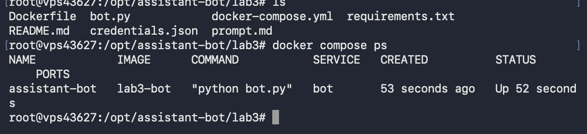
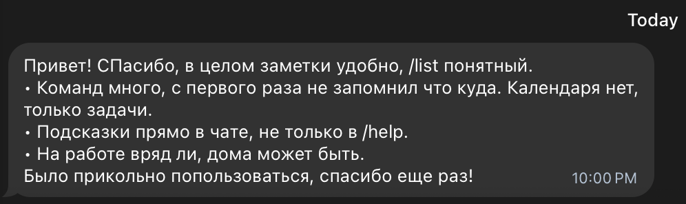
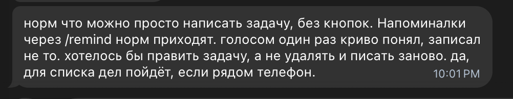

University: [ITMO University](https://itmo.ru/ru/)
Faculty: [FTMI](https://ftmi.itmo.ru/)
Course: [Vibe Coding for Business](https://ex-itmo-ict-faculty.github.io/vibe-coding-for-business/)
Year: 2026/2027
Group: U4225
Author: Михно Андрей Анатольевич
Lab: Lab3
Date of create: 10.10.2026
Date of finished: 16.10.2026

# Лабораторная работа 3: Запуск бота для реальных пользователей

**Бот:** [@itmoftmi_am_bot](https://t.me/itmoftmi_am_bot) — работает круглосуточно на собственном VPS.

## 1. Описание деплоя

**Способ:** Docker + docker compose на собственном VPS (Ubuntu 24.04 LTS, Амстердам).

**Почему этот вариант, а не Railway/Render или ngrok:**
- сервер у меня уже есть, хостинг не нужно оплачивать отдельно и нет ограничений бесплатных тарифов
  (засыпание, лимит часов);
- ngrok требует постоянно включённого компьютера — для бота, который присылает напоминания,
  это не подходит;
- Docker даёт одинаковое окружение локально и на сервере, а `restart: unless-stopped`
  поднимает бота после падения или перезагрузки сервера;
- бот работает через **long polling** (сам опрашивает Telegram), поэтому на сервере не нужны
  входящие порты, домен, HTTPS-сертификат и `setWebhook`;
- полный контроль над данными: SQLite и ключи лежат только на моём сервере.

**Архитектура:**

```
Telegram ◄──── long polling ────┐
                                 │
   VPS (Ubuntu 24.04, Docker)    │
   ┌─────────────────────────────┴──────────┐
   │  контейнер assistant-bot (python:3.12) │──► OpenAI API (речь, разбор команд)
   │    bot.py                              │──► Google Calendar API
   │    /app/data/bot.db ◄── volume bot-data│
   │    /app/credentials.json (read-only)   │
   └────────────────────────────────────────┘
```

**Подготовка проекта (требования методички):**

| Требование | Как выполнено |
|---|---|
| Токен в переменных окружения | `.env` (BOT_TOKEN, OPENAI_API_KEY, GOOGLE_CALENDAR_ID, OWNER_ID), передаётся через `env_file` |
| `.gitignore` | `.env`, `credentials.json`, `*.db`, `*.log`, `*.pyc`, `__pycache__/`, `.venv/` |
| `requirements.txt` с версиями | все зависимости зафиксированы (`==`) |
| Логирование | модуль `logging`: время, уровень, логгер, сообщение; уровень INFO; логи в `docker compose logs` с ротацией 3×10 МБ |
| Обработка ошибок | из Lab1–2: глобальный error handler, фразы пользователя не теряются при сбоях API |
| Dockerfile | `python:3.12-slim`, `/app`, `pip install --no-cache-dir`, `python bot.py` |
| docker-compose.yml | сервис `bot`, `env_file: .env`, `restart: unless-stopped`, volume для БД |
| Секреты не попадают в образ | `.dockerignore` исключает `.env`, `credentials.json`, `*.db` |

**Подготовка бота к чужим пользователям.** До Lab3 бот был рассчитан на одного человека.
Google Calendar — личный, поэтому без доработки тестировщики создавали бы события в моём
календаре, а `/events` показывал бы им мои встречи. Перед деплоем добавлено (промпт —
[prompt.md](prompt.md)):
- `OWNER_ID` — календарь (создание событий голосом и `/events`) доступен только владельцу,
  у остальных голосовое-событие сохраняется как задача с пояснением;
- таблица `usage` и команда `/stats` (только владельцу) — статистика использования для отчёта:
  число пользователей, действия по типам, активность за 24 часа.

## 2. Процесс деплоя

### Пошаговая инструкция

```bash
# 1. На сервере: проверка окружения
cat /etc/os-release | head -2; docker --version; git --version

# 2. Клонирование репозитория (публичный — SSH-ключ GitHub на сервере не нужен)
git clone -b lab3 https://github.com/andrewmikhno/2026-chatbots-u4225-mikhno-a.git /opt/assistant-bot

# 3. С локальной машины: передача секретов (их нет в Git)
scp lab3/.env lab3/credentials.json root@<server>:/opt/assistant-bot/lab3/

# 4. Установка плагина Docker Compose (см. «Проблемы»)
mkdir -p /usr/local/lib/docker/cli-plugins && curl -fSL \
  "https://github.com/docker/compose/releases/latest/download/docker-compose-linux-$(uname -m)" \
  -o /usr/local/lib/docker/cli-plugins/docker-compose && chmod +x /usr/local/lib/docker/cli-plugins/docker-compose

# 5. Сборка и запуск
cd /opt/assistant-bot/lab3 && docker compose up -d --build && docker compose logs -f
```

**Обновление после изменений:**
`cd /opt/assistant-bot && git pull && cd lab3 && docker compose up -d --build`

### Скриншоты

Окружение сервера и клонирование репозитория:



Сборка образа и запуск: OpenAI и Google Calendar подключены, владелец определён,
планировщик напоминаний запущен:



Контейнер работает:



### Проблемы и решения

| Проблема | Решение |
|---|---|
| `docker compose up -d` → `unknown shorthand flag: 'd' in -d`. Docker на сервере установлен из пакета Ubuntu (`29.1.3-0ubuntu3`), в котором нет плагина Compose, поэтому `compose` не распознаётся как команда. | Установлен официальный бинарник Docker Compose v2 в `/usr/local/lib/docker/cli-plugins/` под архитектуру сервера. |
| Секреты (`.env`, ключ Google) нельзя хранить в Git, но они нужны на сервере. | Переданы через `scp`; в контейнер — через `env_file` и read-only volume; `.dockerignore` не пускает их в образ. |
| Личный календарь владельца стал бы доступен тестировщикам. | `OWNER_ID`: календарь и `/stats` только для владельца. |
| Два экземпляра бота с одним токеном конфликтуют (Telegram отдаёт обновления только одному). | Локальный бот остановлен перед запуском на сервере. |
| База SQLite пропадала бы при пересборке контейнера. | БД вынесена в именованный volume `bot-data` (`DB_PATH=/app/data/bot.db`). |
| Логи контейнера могут со временем занять весь диск. | Ротация логов `json-file`: максимум 3 файла по 10 МБ. |
| При входе сервер сообщает `*** System restart required ***` (обновления ядра). | Перезагрузка безопасна: Docker стартует при загрузке, контейнер поднимается сам благодаря `restart: unless-stopped`. |

## 3. Сбор фидбека

**Как собиралось:** ссылка на бота отправлена двум знакомым, они пользовались ботом
около трёх дней и ответили в Telegram на вопросы из методички. Статистика —
команда `/stats` (только владельцу).

**Текст приглашения:**

> Привет! Сделал Telegram-бота — личного ассистента: @itmoftmi_am_bot
> Ему можно писать задачи текстом или **голосом**: «надо срочно купить подарок маме»,
> «запиши идею: …», «напомни через 30 минут…» (`/remind 30m текст`). Есть список дел `/list`
> и заметки `/notes`. Попользуйся пару дней и ответь, пожалуйста, на 4 вопроса:
> 1. Что понравилось?
> 2. Что не понравилось?
> 3. Что можно улучшить?
> 4. Стал(а) бы пользоваться таким ботом?

**Пользователи:** 2 человека (Telegram id `1932420900` и `8797929702`).

**Отзыв 1** (`8797929702`): заметки и `/list` удобны; команд много, с первого раза
не запомнил что куда; календаря нет, только задачи; хотел подсказки прямо в чате,
не только в `/help`; на работе вряд ли, дома может быть.



**Отзыв 2** (`1932420900`): понравилось писать задачу текстом без кнопок, напоминания
через `/remind` приходят; голос один раз криво распознал; хотелось бы править задачу,
а не удалять и писать заново; для списка дел пользовался бы, если рядом телефон.



**Статистика использования (`/stats`)** после трёх дней теста:

| Показатель | Значение |
|---|---|
| Пользователей | 2 |
| Действий всего | 19 |
| За 24 часа | 7 действий от 2 пользователей |
| В базе | задач 3, заметок 3, напоминаний 2 |

По типам действий: `text_task` 5, `note` 3, `remind` 3, `voice_event` 2, `voice_note` 2,
`done` 2, `delete` 1, `voice_task` 1.

Оба тестировщика не только открыли бота, но и реально ставили задачи, заметки
и напоминания; активность есть и за последние сутки, и за предыдущие дни.

## 4. Анализ фидбека

Тестировщики сошлись на том, что **базовый сценарий работает**: написать задачу
обычным текстом, посмотреть `/list`, сохранить заметку, получить напоминание.
Это совпадает со статистикой: больше всего действий — `text_task` и `note`.

**Что не зашло:**
- голосовой ввод один раз записал не то — для не-владельца ошибка распознавания
  сразу попадает в список задач, без шага «подтверди»;
- команд много, `/help` читают не все — ожидают подсказку в чате после `/start`;
- нет календаря у обычного пользователя — это ожидаемо: личный Google Calendar
  закрыт через `OWNER_ID`, но в приглашении про календарь не было сказано, поэтому
  восприняли как недоделку;
- нельзя отредактировать задачу: только `/delete` и заново.

**Готовность пользоваться.** Оба ответили осторожно: да, как простой список дел
с телефона / дома; как рабочий инструмент — нет. Для учебной версии этого достаточно:
бот понятен, но не заменяет заметки в Telegram или календарь.

## 5. Улучшения

**До запуска (по итогам Lab2 и подготовки к реальным пользователям):**
- календарь и статистика закрыты от посторонних (`OWNER_ID`);
- журнал действий и `/stats`;
- исправлены ошибки, найденные на демо Lab2: просьба «покажи заметки» больше не
  превращается в задачу, «на 2 часа» понимается как длительность, ссылка на событие без превью.

**По итогам фидбека (в следующих итерациях):**
- короткое меню подсказок после `/start` (задачи / заметки / напоминания), чтобы
  не искать команды в `/help`;
- команда правки задачи (`/edit N текст`) вместо «удали и напиши заново»;
- перед сохранением голосовой задачи — показать распознанный текст и спросить
  подтверждение;
- в `/start` для не-владельца явно писать, что календарь недоступен, чтобы это
  не выглядело багом.

## 6. Выводы

Бот развёрнут в Docker на собственном VPS и работает круглосуточно без входящих
портов и webhook. Секреты не попадают ни в Git, ни в образ, данные переживают
пересборку контейнера, а бот сам поднимается после сбоев и перезагрузок.

Два внешних пользователя пользовались ботом около трёх дней: 19 действий,
задачи / заметки / напоминания в базе, отзывы в целом положительные по простому
сценарию «написал — лежит в списке». Главные претензии — к UX (команды, правка,
голос), а не к деплою или падениям. Для Lab3 это как раз нужный результат:
проверили, что контейнер живёт на сервере и что чужие люди могут пользоваться
ботом, не трогая чужой календарь.

**Что можно улучшить дальше.**
- **CI/CD через GitHub Actions** — бота планирую развивать дальше, поэтому деплой стоит
  автоматизировать: при пуше в основную ветку workflow подключается к серверу по SSH
  (приватный ключ — в GitHub Secrets, публичный — в `authorized_keys` на сервере)
  и выполняет `git pull && docker compose up -d --build`. Туда же — прогон тестов и линтера.
- Публиковать готовый образ в GitHub Container Registry, чтобы не собирать его на сервере.
- Резервное копирование volume с базой SQLite по расписанию.
- Мониторинг: уведомление в Telegram, если контейнер перезапускался.
